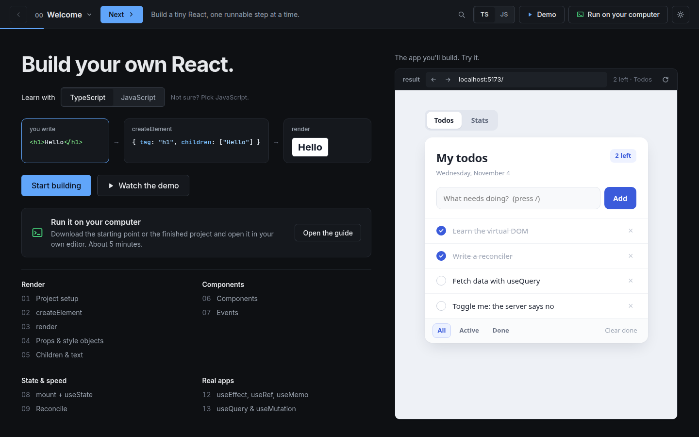
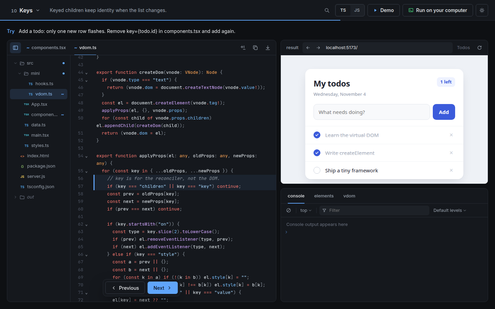
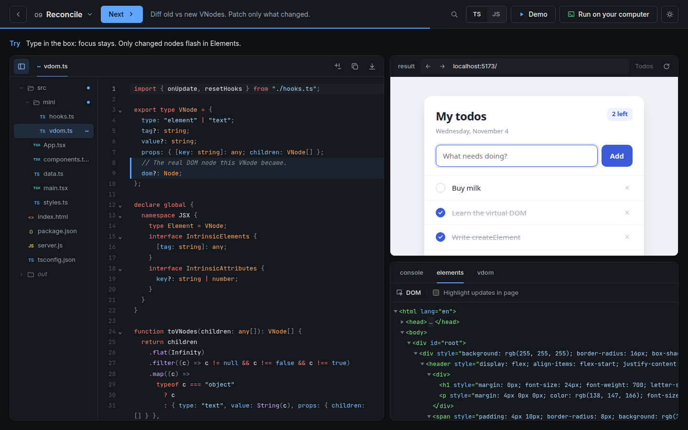
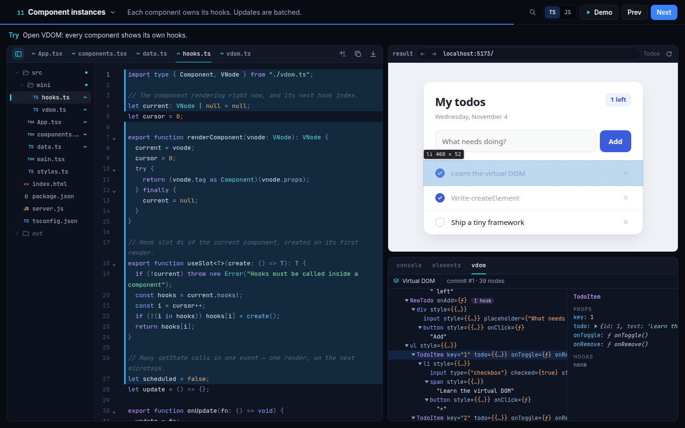
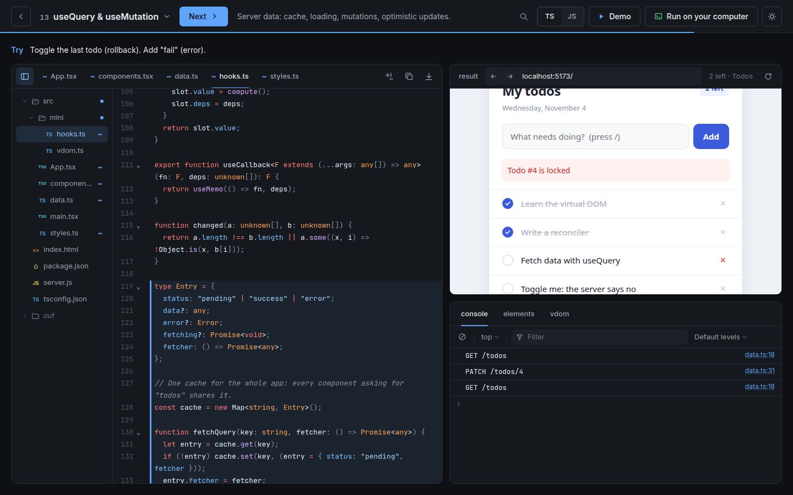
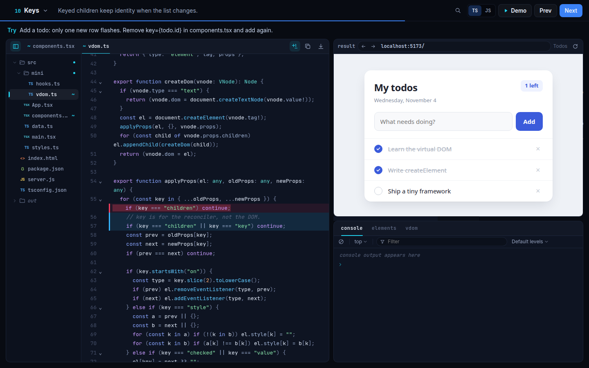
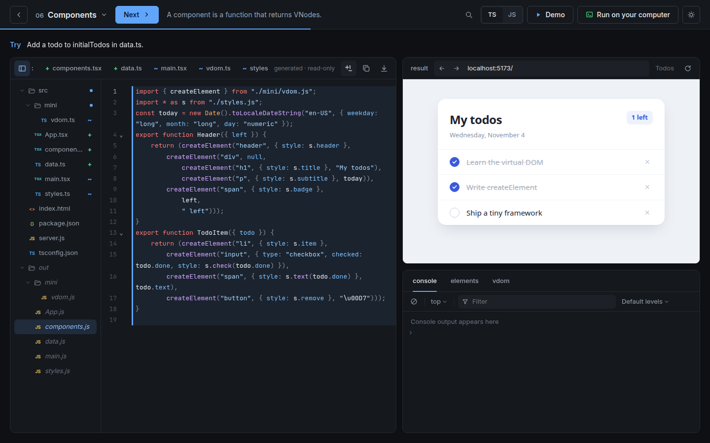
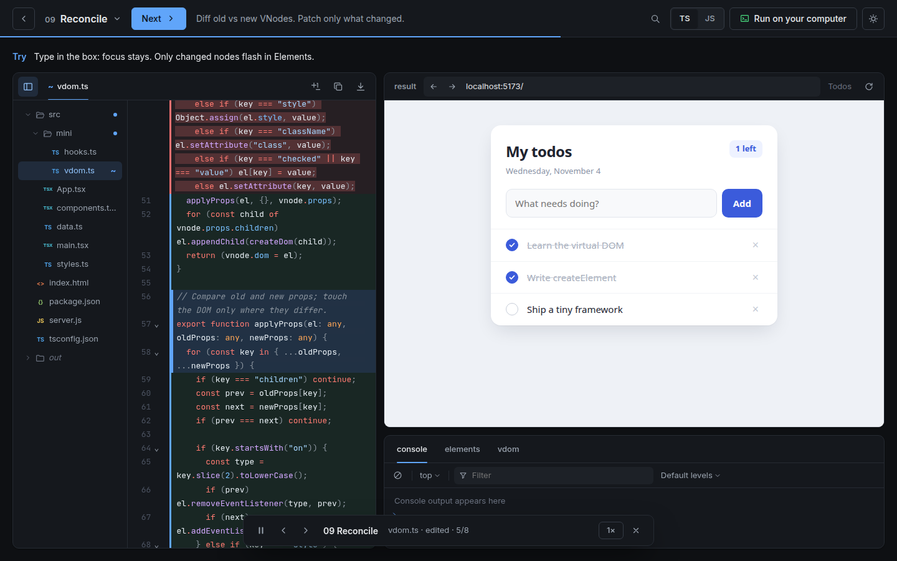

# Build Your Own Frontend Framework

Build a React-like framework from scratch, one step at a time, in the browser.
Each step changes a few files of a real project, and the lines it adds are
highlighted. A todo app runs live next to the code, with DevTools that show
what your framework does to the DOM.





## What you build

About 300 lines of framework in 3 files under `src/mini/`, with no dependencies:

| Step | You add |
| --- | --- |
| 01 | `server.js` turns `src/` into `out/` (TypeScript compiler, like UraJS); JSX points at *your* `createElement` |
| 02–03 | `createElement` (virtual DOM) and `render`, in `src/mini/vdom.ts` |
| 04–07 | props and `style={{…}}` objects, children, components, events |
| 08 | `mount` + `useState` in `src/mini/hooks.ts` (full re-render: watch focus get lost) |
| 09–10 | a reconciler (diff + patch) and keyed children |
| 11 | component instances: per-component hooks, batched updates, `useReducer` |
| 12 | `useEffect` with cleanup, `useRef`, `useMemo`, `useCallback`, custom hooks |
| 13 | `useQuery` / `useMutation`: cache, loading, optimistic updates, rollback |
| 14 | a hash router (`Link`, `Router`) |
| 15 | the polished app; download the starting point or the finished project, run with `npm install && npm run dev` |

## Watch your framework work

The **Elements** tab flashes every DOM node your code changes. At step 8 the
whole tree flashes on every keystroke. After the reconciler, only the changed
text does.



The **VDOM** tab shows each committed virtual DOM tree, with every component's
hooks and the nodes that changed since the last render.



The **Console** behaves like the browser's console. It has expandable objects,
warning and error rows, and source links that jump to the line. It also has a
REPL and filtering.



**Compare with previous step** shows exactly what the step changed.



The learner's project works like UraJS: `server.js` compiles every `src/` file into `out/` with
TypeScript's `transpileModule` (JSX → `createElement(...)`, imports rewritten to `.js`), and
`index.html` loads `out/main.js` as a plain ES module. No bundler.



## Using it

Written for beginners: you know basic JavaScript (or TypeScript), nothing about frontend tooling.
Nothing to install: the whole course runs in the page.

| Where | What it does |
|---|---|
| Intro (step 00) | The idea, the finished app running live, the road ahead. Pick TypeScript or JavaScript. |
| Top bar | Step title and goal. Click the title for every step. |
| Bar over the editor | **Previous** and **Next**. `←` / `→` also change steps. |
| Top bar, right | **Demo** plays the course by itself. **Run on your computer** opens the setup guide. The sun / moon button switches light and dark (dark by default). |
| « Try » line | One thing to do in this step. |
| Editor tabs | The files this step touched: `+` new, `~` changed. The added lines are highlighted. The file tree has the rest. |
| `out/` folder (bottom of the file tree) | The plain JavaScript the browser runs, made from `src/` by the TypeScript compiler, exactly like UraJS: `src/App.tsx` → `out/App.js`. Read-only. |
| Compare button | What this step changed, removed lines included. |
| Result + console / elements / vdom | Your app, its logs, its DOM (changed nodes flash) and its virtual DOM. |
| Gaps between panes | Drag to resize, double-click to reset. |
| Download button | « Run it on your computer »: 5 short steps (install Node.js, download, `cd`, `npm install`, `npm run dev`). Downloads: **Starting point** (step 01), **Finished project**, or **This step**. |

| Mode | Files |
|---|---|
| TypeScript | `.ts` / `.tsx`, `tsconfig.json` |
| JavaScript | the same course with the types removed: `.js` / `.jsx`, no `tsconfig.json`. Edits are kept per mode. |

**Demo** opens every changed file of a step, scrolls to each added, edited or removed part and spotlights it.
Moving to the next step outlines what changed in the app. Space pauses, `←` / `→` skip, Esc stops.



## Run this repo

You need [Node.js](https://nodejs.org) (the LTS version).

| Need | Command |
|---|---|
| Run the course at http://localhost:5173 | `make dev` |
| Type-check + unit tests (every step builds in both modes) | `make check` |
| Production build into `dist/` | `make build` |

Open items: [`PLAN.md`](PLAN.md).

## How it works

```
src/
├─ main.ts
├─ pages/course/index.ts      the course page: intro, step flow, demo mode, resizing, TS/JS mode
├─ _components/
│  ├─ atoms/                  dom.ts (h, icons, safeStorage) · icons.ts
│  ├─ molecules/              quickOpen.ts · setupGuide.ts (« Run it on your computer »)
│  └─ organisms/              editor.ts · explorer.ts · preview.ts · devtools/ (console, elements, vdom)
├─ sandbox/                   bundler.ts (runs the code in the page) · runtime.ts (inside the preview) · outjs.ts (out/ files)
├─ steps/                     the course: course.ts (what each step teaches) · code.ts (every file at step n)
│                             01-setup.ts · index.ts (`//!` comments, imports) · js.ts (JavaScript mode)
├─ utils/                     diff · zip · uidiff · pretty
├─ types/protocol.ts          messages page ⇄ preview
└─ styles/                    tokens.css (colors) · globals.css
```

The learner's finished project (13 files):

```
index.html  package.json  tsconfig.json  server.js
src/
├─ main.tsx  App.tsx  components.tsx  pages.tsx  data.ts  styles.ts
└─ mini/     vdom.ts (createElement, render, reconcile, mount) · hooks.ts · router.ts
```

The preview runs in a same-origin iframe loaded from a blob URL. It is not
sandboxed, because Chrome blocks hash navigation in opaque-origin blob documents.
That's fine here, because the only code that runs in the preview is code you
typed yourself.
